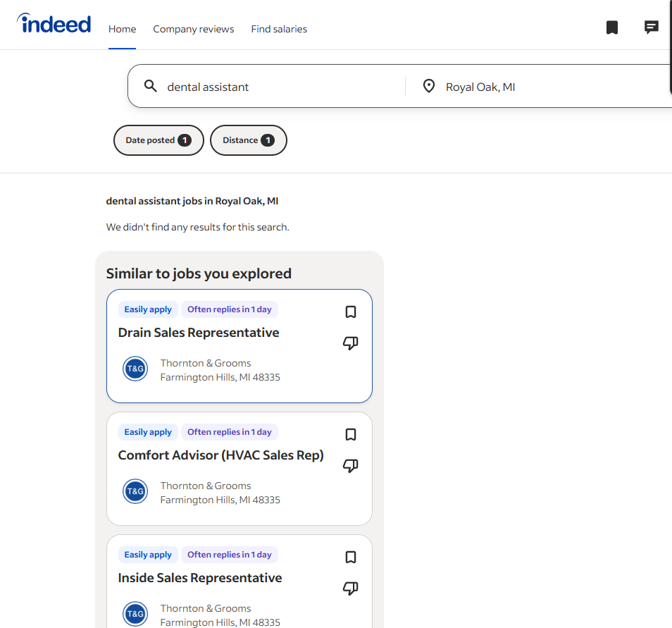
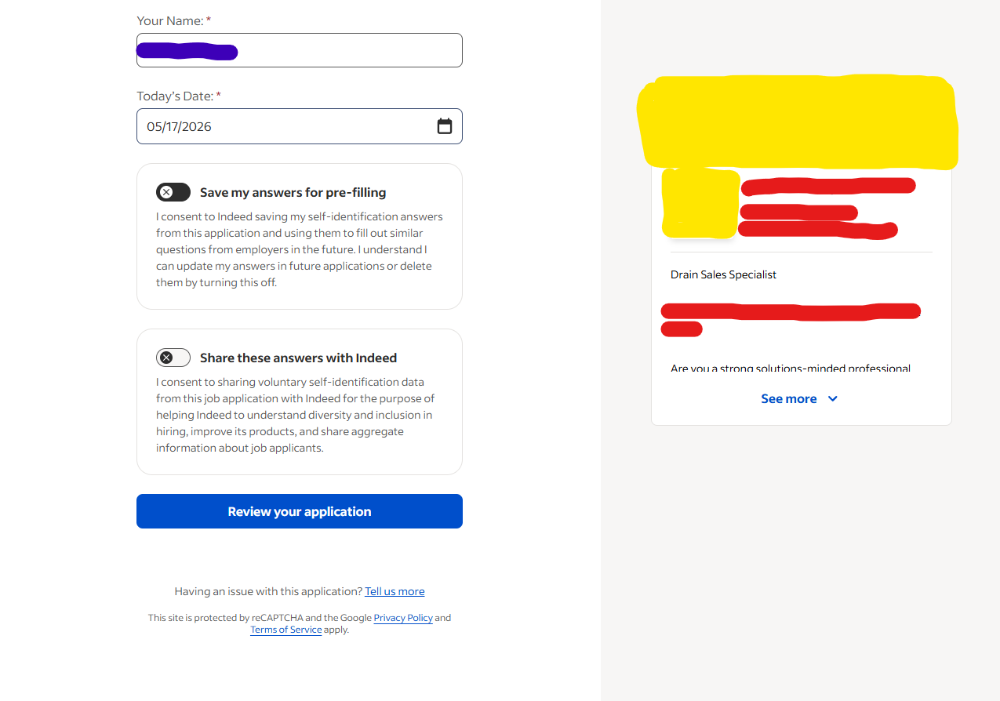
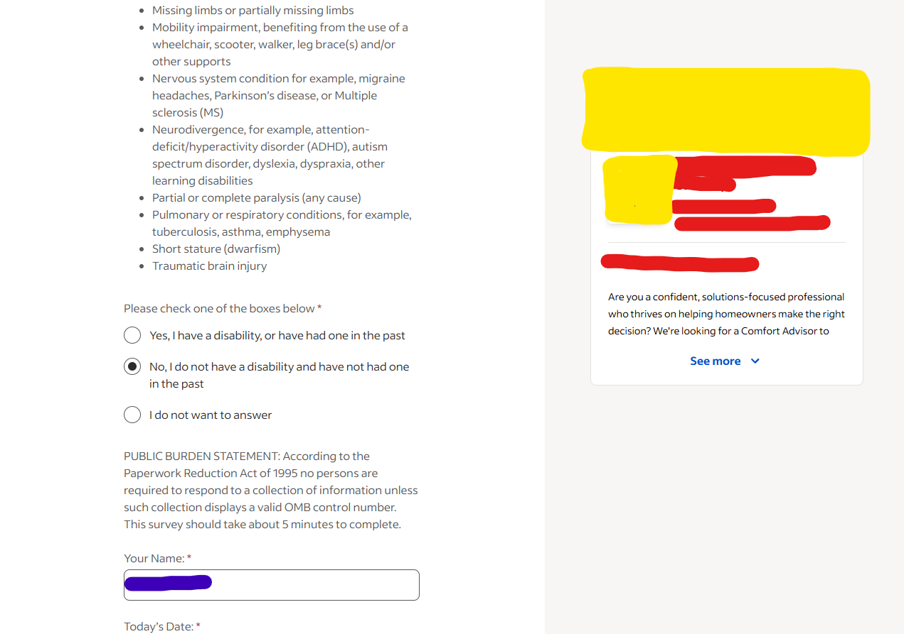
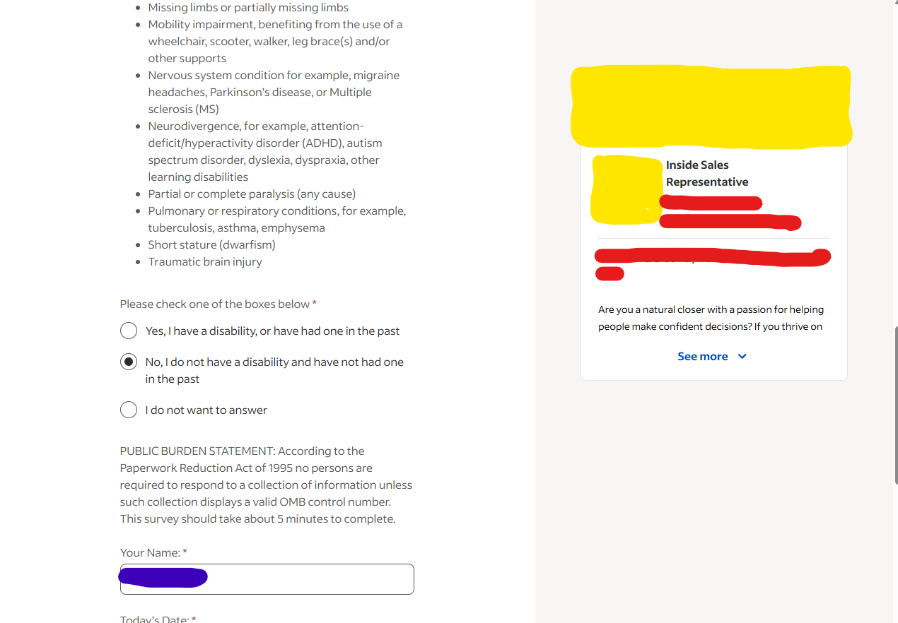

# indeed-agent

Autonomous browser agent that walks Indeed Easy Apply listings end-to-end. Searches jobs from a natural-language prompt, scores matches, fills application forms via a keyword map with a Claude LLM fallback, and stops at submit in dry-run mode.

## What it does

Give it a prompt like:

```
apply to 10 graphic design jobs in Farmington, MI
```

…and it will:

1. Parse the prompt (role + location + count) via `prompt_parser.py`
2. Search Indeed and collect job cards (`job_searcher.py`)
3. Score each listing against your profile (`job_scorer.py`)
4. Walk the Easy Apply form step-by-step (`form_filler.py`), answering questions from `data/user_profile.yaml` first, then falling back to Claude (Haiku) via `llm_answerer.py`
5. Stop at the submit button in `--dry-run` mode (never submits real applications unless explicitly allowed)

## Screenshots

Job listing detected on Indeed:



The agent walking an Easy Apply form:







Final review / would-submit step (dry-run halts here):


## Setup (run these in order)

Complete all four steps before turning the agent loose. The application loop
still runs if a step is skipped, but it prints a loud warning and may misbehave
(incomplete answers, resumes that overclaim, or failed submissions).

```powershell
poetry install
```

**1. Profile questionnaire**: collect your personal, work, and education data
into `data/user_profile.yaml`:

```powershell
poetry run python src/main.py profile
```

**2. Skills builder**: a small local web UI. Enter your field, Claude generates
~100 relevant skills, and you click Yes / No / Skip on each. Yes-answers become
your `skills` allowlist and No-answers become a `non_skills` denylist, so tuned
resumes never claim a skill you don't actually have.

```powershell
poetry run python src/main.py skills
```

Open http://localhost:8765, fill it out, and click Save. The server stops
itself once you Save, so you can move straight to step 3. (To preview without
writing your profile, run the dry-run harness
`python test-questionarre/server.py` instead; it writes
`test-questionarre/proposed_changes.yaml` and leaves `user_profile.yaml`
untouched.)

**3. Indeed login**: seed your persistent Indeed session:

```powershell
poetry run python src/main.py login
```

**4. Application loop**: run the agent (see modes below).

### Live mode (actually applies)

```powershell
poetry run python src/main.py "apply to 10 graphic design jobs in Farmington, MI" `
  --resume "C:\path\to\resume.pdf"
```

This submits real applications. Each Easy Apply walk ends by clicking the real submit button.

### Dry-run (test / debug)

Add `--dry-run` to walk the whole flow without submitting. The submit button becomes a no-op that logs intent and dumps the final page as `*-would-submit.*` in `data/debug/`. Useful for verifying selectors and field handling on a new job category before turning it loose.

```powershell
poetry run python src/main.py "apply to 10 graphic design jobs in Farmington, MI" `
  --resume "C:\path\to\resume.pdf" --dry-run
```

### Other flags

- `--debug`: dump every page as HTML + PNG to `data/debug/` (implied by `--dry-run`).
- `--resume <path>`: resume PDF to upload during the application.

## Architecture

| File | Role |
|---|---|
| `src/main.py` | CLI entry (`profile` / `skills` / `login` / prompt). Parses `--debug`, `--dry-run`, `--resume`. Warns on unmet setup prerequisites. |
| `src/skills_questionnaire.py` | Local web UI (setup step 2): Claude generates ~100 field skills; Yes/No/Skip builds the `skills` allowlist + `non_skills` denylist. |
| `src/agent.py` | Orchestrator: parse → search → score → apply. |
| `src/browser.py` | Playwright launch, page dumping, screenshots. |
| `src/job_searcher.py` | Indeed search + listing collection + job-detail extraction. |
| `src/form_analyzer.py` | Scans form pages for inputs/selects/textareas/radios. |
| `src/form_filler.py` | Step loop, `FIELD_MAP` keyword table, submit gate. |
| `src/llm_answerer.py` | Claude (Haiku) fallback for unknown fields, in first person. |
| `src/field_inventory.py` | Per-run dedup + summary of every field seen. |
| `src/prompt_parser.py` | Claude parse of the natural-language request into a search intent. |
| `src/job_scorer.py` | Claude match score (0-100) + pass/fail gate per listing. |
| `src/claude_client.py` | Anthropic API shim: system + prompt → JSON, used by the three LLM modules. |

## Safety

The default mode submits real applications; this app is built to work. Use `--dry-run` whenever you're iterating on selectors, profile data, or a new job category. It walks the entire flow and stops at submit, logging intent and dumping the final page as `*-would-submit.*`. Once you've verified a run looks clean, drop the flag and go live.

## Requirements

- Python 3.11+ via Poetry
- Playwright (auto-installed via Poetry)
- `ANTHROPIC_API_KEY` set in the environment (Claude API access)
